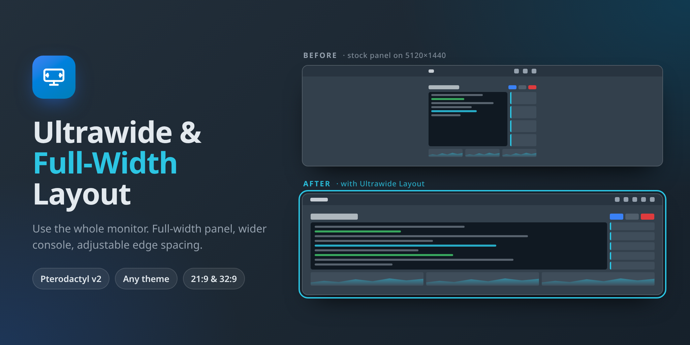

# Ultrawide Layout for Pterodactyl v2



The Pterodactyl panel stops at 75rem (1200px) wide, which leaves most of a 21:9 or 32:9 monitor empty. This extension lets the panel span the window while keeping comfortable spacing at the edges.

- The dashboard, server pages, admin area and navigation bar span the window.
- Edge spacing scales with the screen: 1rem on phones, up to 3rem on wide monitors.
- On screens 2200px and wider, the console's power buttons and stat tiles get a fixed-width column and the terminal takes the rest.
- On screens 900px and taller, the console grows with the window.
- An optional maximum width caps the layout if full width is too much.
- It works with any theme. This is an extension, not a theme, so the theme you use now stays active.

Requires **Pterodactyl Panel 2.0** (tested on `2.0.0-beta.2`, SDK `2.0.0-beta.6`). It does not work on 1.x.

## Install

Download `ultrawide-layout-<version>.pteroext` from [Releases](../../releases), then either:

- In the panel, go to **Admin → Extensions → Install**, choose the file, and enable it.
- Or, from the panel directory, run: `php artisan p:extension:install /path/to/ultrawide-layout-1.0.0.pteroext --enable`

## Settings

Change these under **Admin → Extensions → Ultrawide Layout → Settings**. No rebuild is needed.

| Setting | Default | What it does |
| --- | --- | --- |
| Edge spacing (rem) | 3 | The most space kept between content and the screen edge. |
| Maximum content width (rem) | 0 | `0` spans the whole window. `75` is the stock width. |
| Reflow the console on wide screens | on | Gives the power buttons and stats a fixed column from 2200px wide. |
| Console side column (rem) | 24 | The width of that column. |
| Tallest console (rem) | 60 | How tall the console can grow on screens 900px and taller. |

Signed-out pages, such as the login screen, use the defaults. The panel only sends extension settings to signed-in users.

## How it works

Panel v2 sets its layout with CSS custom properties: `--layout-content-width`, `--layout-gutter` and `--layout-page-spacing`. They are documented in the SDK's `THEMES.md`. [`src/client/styles.css`](src/client/styles.css) overrides them. The stylesheet is plain CSS with no Tailwind layers, so it passes the panel's install check and loads after the active theme's stylesheet. [`src/client/apply.ts`](src/client/apply.ts) writes the admin settings onto `<html>` as variables.

Limitations:

- The console reflow targets the stock console page, which Theme Studio and most themes keep. A theme that replaces the console page keeps its own layout there.
- Pterodactyl v2 is still in beta, and its class names can change between betas. If the console reflow stops working after a panel update, open an issue.

## Development

The extension's directory name must match its id, so clone it into your panel's `extensions` folder as `ultrawide-layout`:

```sh
cd /var/www/pterodactyl/extensions
git clone https://github.com/LOCKhart07/pterodactyl-ultrawide-layout.git ultrawide-layout
cd ultrawide-layout
npm install
npm run typecheck && npm test && npm run build
php ../../artisan p:extension:doctor .
php ../../artisan p:extension:pack . --output=ultrawide-layout-1.0.0.pteroext
```

`npm test` needs the SDK's test runtime, which you build with `npm run sdk:testing` from a panel source checkout. CI does this for you.

## AI disclosure

This extension was written with substantial help from Claude (Anthropic). The CSS, the settings code, the packaging and the cover image were AI-generated under my direction, and I tested them on my own panel.

## License

[MIT](LICENSE)
